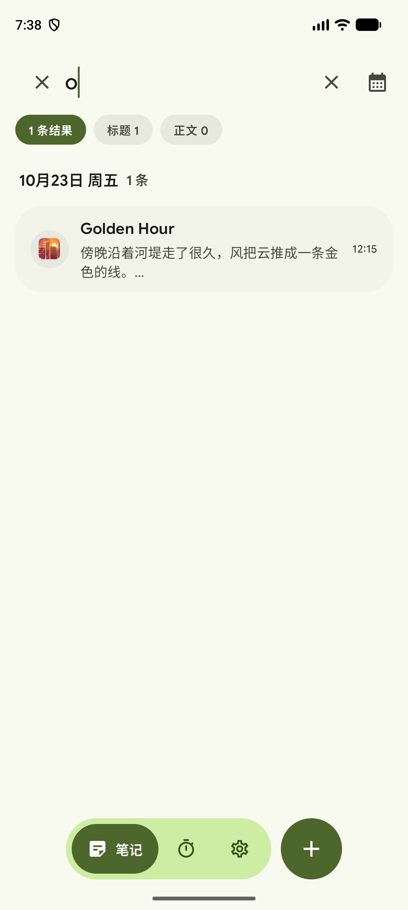
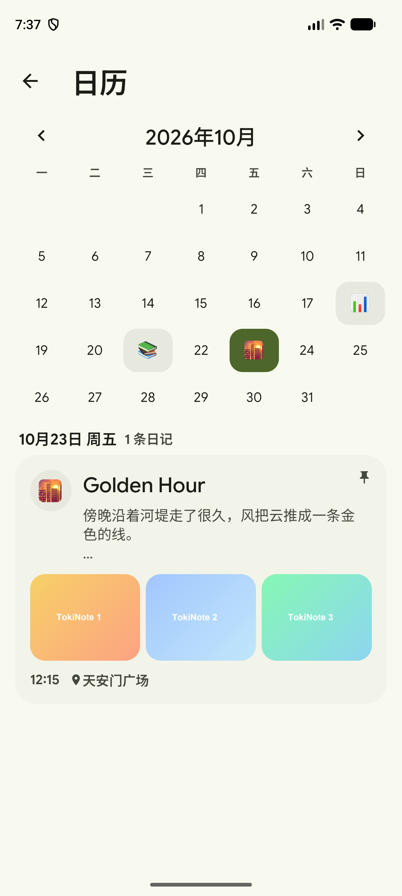
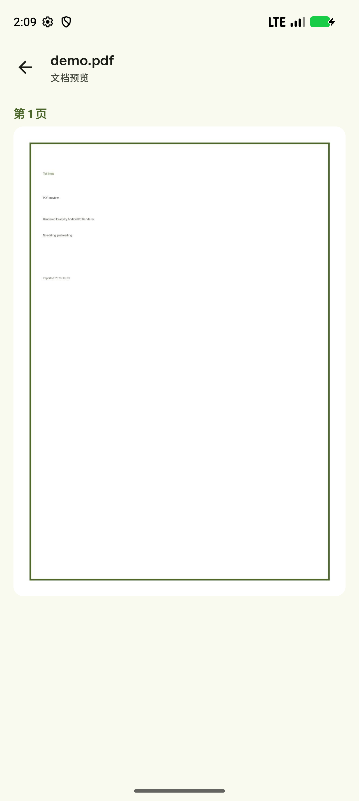
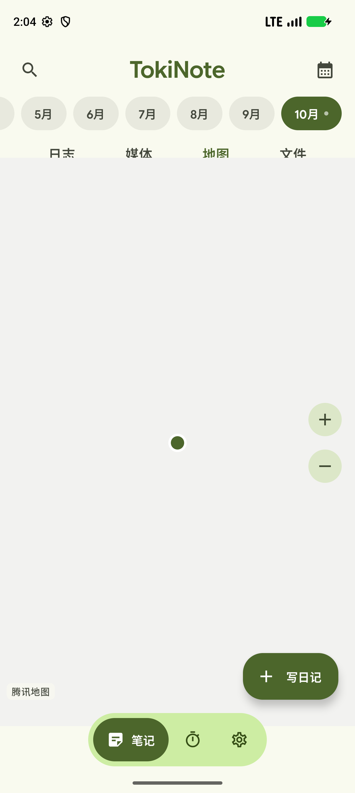

# TokiNote

本地优先的笔记 + 专注应用。设计语言以 [Tomato](https://github.com/nsh07/Tomato) 为基准，遵循
Material 3 Expressive：大圆角、胶囊形控件、胶囊悬浮导航栏、分段列表与 Google Sans Flex 字体。

| 日志时间线 | 搜索结果 | 专注 |
| --- | --- | --- |
|  |  |  |

| 专注总结 | 计时器设置 | 关于 |
| --- | --- | --- |
|  |  |  |

| 日历 | 文档预览 | 腾讯地图 |
| --- | --- | --- |
|  |  |  |

## 笔记页（参考 June）

笔记页按 [June](https://github.com/DenserMeerkat/June)（GPL-3.0）的日记时间线重构，底栏是 TokiNote 自己的胶囊导航：

- 顶部：左对齐的「TokiNote」标题（点按展开搜索）+ 日历入口
- 搜索：标题命中 / 正文命中的结果先按类型统计，再按日期分组放进大圆角容器
- 底部：胶囊导航 + 右侧独立「写日记」圆形按钮（FAB 并入底栏）
- 月份条：自动滚动到当前月，有日记的月份带圆点
- 分类页签：**日志 / 媒体 / 地图 / 文件**（原 June 的 Music 替换为 Files）
- 日志：按天分组的卡片，含 emoji、标题、正文预览、图片拼贴、附件、位置与时间
- 媒体：按日期分组的图片网格
- 文件：按日期分组的文档列表，点击进入只读预览
- 日历页：月视图，有日记的日子显示当天 emoji，选中日直接列出当天日记
- 编辑器：June 式顶栏（关闭 / emoji / 添加 / 保存 / 更多），图片九宫格、日期标签、附件卡片、位置卡片，
  底部工具条保留并整合了原来的**字号 / 字重**调整

### 文件导入与预览

支持从系统文件选择器导入 `.pdf`、`.docx`、`.pptx`、`.xlsx`（以及旧版 `.doc/.ppt/.xls`，可导入但只做兼容处理）：

- PDF：使用系统 `PdfRenderer` 在本地逐页渲染，只读、无编辑
- DOCX / PPTX：解析 OOXML 文本，按段落 / 幻灯片分页展示
- XLSX：解析共享字符串与工作表，按表格行展示
- 文件副本保存在 `filesDir/files`，断网、换机前一直可用

### 腾讯地图

地图页使用腾讯地图瓦片（`rt0-3.map.gtimg.com`，GCJ-02 坐标系），支持拖动、缩放、点击标记打开对应日记；
添加位置时可在图上点选坐标并命名。无需腾讯地图 SDK / API Key，但**加载瓦片需要设备联网**。

## 功能

### 笔记
- 按天组织的日记，emoji 心情、标题、正文，输入即自动保存到本地
- 置顶、标签分组、搜索（标题 / 正文）
- 图片附件（多选导入，网格拼贴，全屏查看）
- 文档附件（pdf / docx / pptx / xlsx），卡片折叠在正文中，点开进入只读预览
- 位置附件：腾讯地图点选坐标并命名，日记里显示位置卡片
- 正文字号（小/中/大）与字重（常规/中等/粗体）

### 专注（番茄钟，行为对齐 Tomato）
- 专注 25 分钟 / 短休息 5 分钟 / 长休息 15 分钟，每 4 段进入长休息
- 开始、暂停、重置、跳过；自动开始下一段
- 「波浪断点」计时环：平滑轨道 + 波浪粗线进度，中心暂停按钮
- ⋮ 菜单进入**专注总结**：本周大数字、7 天柱状图、最近记录
- 计时设置：三选一胶囊按钮 + 「自定义」（调用系统时间选择器）
- 底栏右侧按钮在此页变为「调整时钟」，直达计时设置

### 应用内更新
- 关于页「检查更新」读取 GitHub Releases API，比对版本号
- 有新版本时展示 release notes，可一键下载 APK 并调起系统安装器
- 未授权「安装未知应用」时自动跳转系统设置

### 设置
- 主题模式：跟随系统 / 浅色 / 深色；纯黑（AMOLED）；动态取色（Android 12+）
- 减弱动效：关闭页面转场与按压缩放
- 数据：笔记数量、复制备份 JSON 到剪贴板、清空全部数据
- 关于：版本分组、检查更新、GitHub 主页链接

## 数据存储

所有数据都保存在设备本地（`SharedPreferences` + JSON），没有账号、没有云端同步；只有「检查更新 / 下载 APK」会访问 `api.github.com` 与 GitHub 的下载地址：

```
tokinote_prefs
├── notes     笔记数组（含格式、颜色、标签、置顶、时间戳）
├── labels    标签数组
├── settings  外观与计时器设置
└── sessions  已完成的专注记录（用于今日统计）
```

卸载应用或「清空全部数据」之前，数据不会离开设备。

## 构建

```bash
# 需要 JDK 17+ 与 Android SDK（compileSdk 37）
./gradlew assembleDebug
# APK: app/build/outputs/apk/debug/app-debug.apk
```

安装：

```bash
adb install -r app/build/outputs/apk/debug/app-debug.apk
```

## 工程结构

```
app/src/main/java/com/tokinote/app/
├── MainActivity.kt            入口，主题（深色 / 动态取色 / 纯黑）
├── data/
│   ├── Note.kt                笔记模型、字号与字重枚举
│   ├── Label.kt               标签模型
│   ├── AppSettings.kt         设置与专注记录模型
│   ├── TokiStore.kt           SharedPreferences + JSON 持久化
│   ├── UpdateChecker.kt       GitHub Releases 检查与 APK 下载
│   └── AppViewModel.kt        单一状态源，所有写操作即时落盘
└── ui/
    ├── TokiNoteApp.kt         导航栈 + Scaffold + 悬浮导航栏
    ├── Dest.kt                页面路由
    ├── Motion.kt              动效开关、弹簧参数与按压缩放
    ├── Format.kt              日期 / 时长格式化
    ├── theme/                 Color、Type、Shape、Theme
    ├── components/            顶栏、悬浮导航栏、胶囊按钮组、分段列表
    ├── notes/                 笔记列表、搜索、编辑器、底部弹层
    ├── focus/                 番茄钟状态机、波浪环、总结页、计时设置
    └── settings/              设置主页与三个子页、APK 安装器
```

## 设计来源与许可

- 视觉设计基准：[Tomato](https://github.com/nsh07/Tomato)（GPL-3.0），本项目复用其调色板、
  形状比例、分段列表与悬浮工具栏式导航的视觉语言。
- 字体：[Google Sans Flex](https://fonts.google.com/specimen/Google+Sans+Flex)，随应用一同打包。
- 组件：Jetpack Compose + Material 3（1.4.0，Expressive 形状与动效）。

## 已知限制

- 计时器在前台运行；退到后台或锁屏后不会继续精确计时（未接入前台 Service）。
- 地图瓦片需要联网；离线时只显示已保存位置的标记与「腾讯地图」标识。
- Office 预览是文本级还原（段落 / 幻灯片 / 表格行），不是逐像素排版；旧版二进制 `.doc/.ppt/.xls` 仅能导入，暂不支持预览。
- 富文本是"整条日记级"的字号/字重，不是选中局部加粗。
