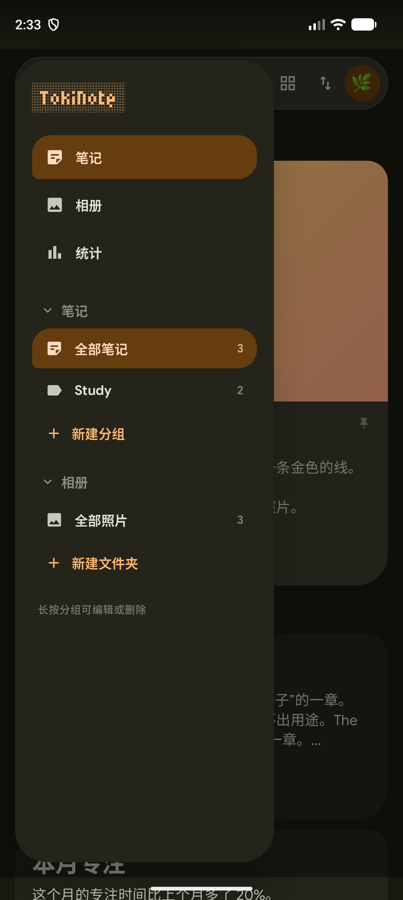
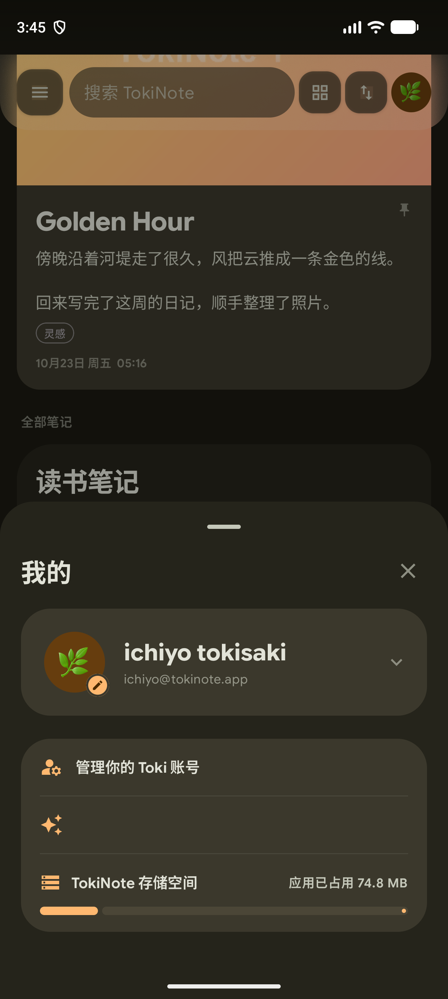

# TokiNote

TokiNote 是一款本地优先的笔记 + 专注应用。

笔记、图片、标签、个人资料和专注记录全部保存在本机；除了「检查更新」和后续的「公告」之外，应用不会发起网络请求。

## 界面

| 主页 | 分组抽屉 | 个人中心 |
| --- | --- | --- |
|  |  |  |

| 编辑器 | 相册 | 图片查看器 |
| --- | --- | --- |
|  |  |  |

| 专注 | 专注总结 | 计时设置 |
| --- | --- | --- |
|  |  |  |

| 外观 | 数据 | 关于 |
| --- | --- | --- |
|  |  |  |

## 笔记

- 顶部控制区：导航、搜索、查看方式、排序、头像各自独立；搜索框只有半透明底、无描边，其余为独立悬浮按钮，长按会显示用途提示
- 笔记列表支持「已置顶 / 全部笔记」分区、两列网格与单列列表；有图时图片在卡片顶部铺满，无图时卡片直接从标题开始
- 长按卡片会从卡片位置展开预览，可直接打开、归档或删除
- 左侧悬浮抽屉：笔记 / 相册 / 统计三个入口，笔记分组与相册文件夹可折叠展开，选中项高亮
- 相册文件夹支持命名、多选照片、查看创建时间、编辑和删除；文件夹只记录照片引用，不复制或删除原图
- 相册支持网格 / 列表切换；点开照片进入全屏查看器，支持双指缩放、双击放大、保存到系统相册、回到原笔记和查看图片信息
- 日历视图按天展示日记，有记录的日期显示当天 emoji，选中日期直接列出当天内容
- 编辑器从首图提取主色，驱动背景、标题、保存按钮和底部工具岛；正文与头部整体滚动，顶栏和工具岛悬浮
- 向下滚动时大标题缩小、日期标签弹性收起，顶栏显示当前标题；回到顶部自动恢复
- 底部工具岛默认收起，点击后弹性展开格式、图片、清单和日期工具；顶部「更多」打开笔记信息面板
- 归档笔记不进入主页且不可编辑；回收站保留 14 天，可恢复或彻底删除

## 专注

- 支持专注、短休息、长休息计时，时长与长休息间隔可自定义
- 大尺寸圆角进度环 + M3E 大胶囊主按钮，重置 / 跳过 / 设置独立排列
- 长按或双击计时数字进入不定时正向计时，重置后回到原计时
- 专注总结展示今日专注 / 休息、上周柱状图和上个月迷你柱状图
- 计时设置提供大号预览、场景切换、预设胶囊和系统时间选择器

## 个人中心

- 点顶栏头像打开个人中心
- 头像可从系统相册选择，也可使用内置 emoji
- 用户名和邮箱可展开编辑，修改立即在全局生效
- 存储卡显示 APK、本地文件和缓存的占用，点击可直接进入系统应用详情
- 管理账号与功能入口当前为占位，点击会提示「功能暂不支持」

## 设置

- 外观：主题模式（跟随系统 / 浅色 / 深色）、配色预设、动态取色、纯黑、显示时间、减弱动效
- 数据：笔记 / 归档 / 回收站数量、备份 JSON、清除缓存、存储占用、清空全部数据
- 关于：版本信息、检查更新（Release / Beta 复合胶囊）、GitHub 主页

## 应用内更新

- 「检查更新」读取 GitHub Releases，比对当前版本后展示更新说明
- 支持 Release 与 Beta 两个通道：
  - Release 只匹配 `0.2.7` 这类标准版本
  - Beta 只匹配 `0.2.9-beta` 这类测试版本
- 有新版本时可直接下载 APK 并交给系统安装器；未授权「安装未知应用」时会跳转系统设置
- 下载失败、网络不可达或没有匹配版本时会在页面内提示，不影响本地功能

## 数据与隐私

- 所有笔记、图片、标签、分组、相册文件夹、个人资料和专注记录都保存在本机
- 支持导出完整 JSON 备份；清除缓存不会删除笔记
- 不接入匿名统计、账号上报或用户画像，不上传用户 ID、邮箱和笔记内容
- 断网时除检查更新外，所有功能均可正常使用

## 设计

以大圆角卡片、悬浮胶囊、毛玻璃、分段列表和弹性动效为主要视觉语言，支持深色 / 浅色、纯黑与动态取色。

## 已知限制

1. 计时器目前仅在前台运行，尚未接入前台 Service
2. 富文本目前是整条日记级别的字号 / 字重，不是局部加粗
3. 应用内更新依赖 GitHub 可达；无法安装时会引导到系统设置授权
