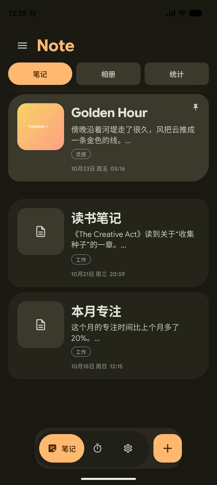
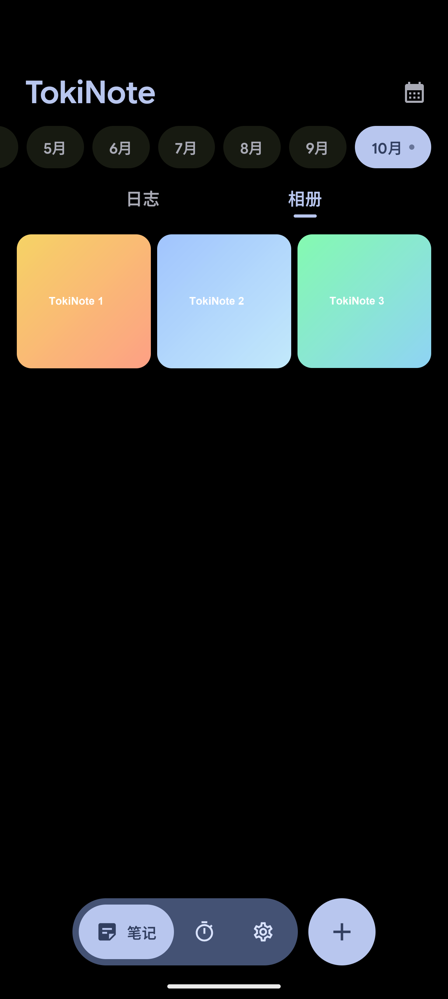
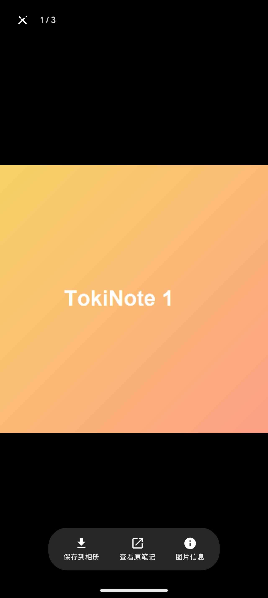
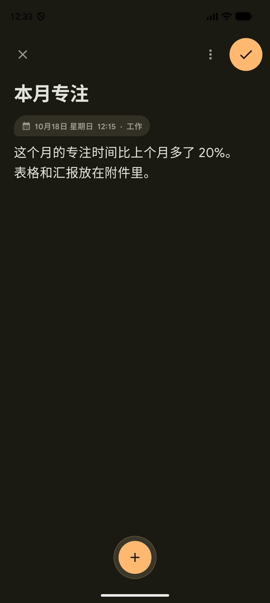
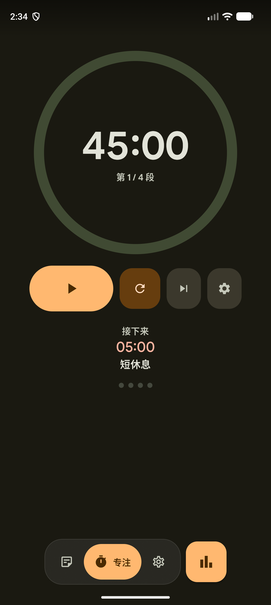
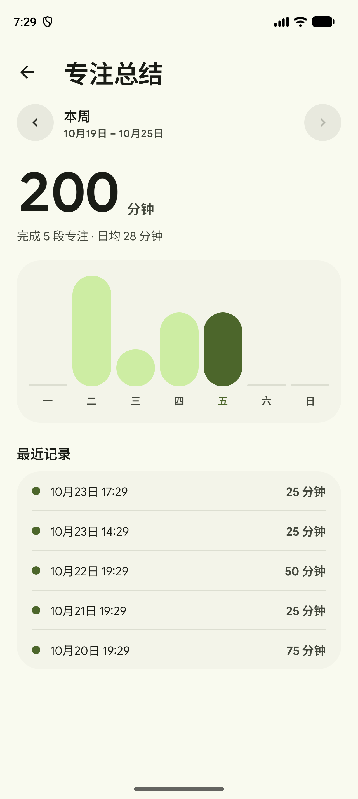
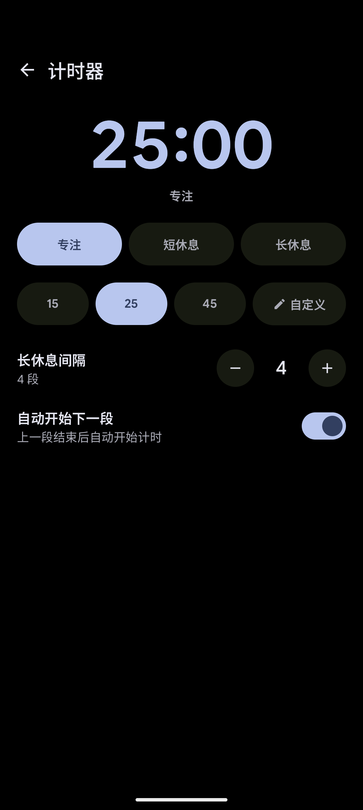
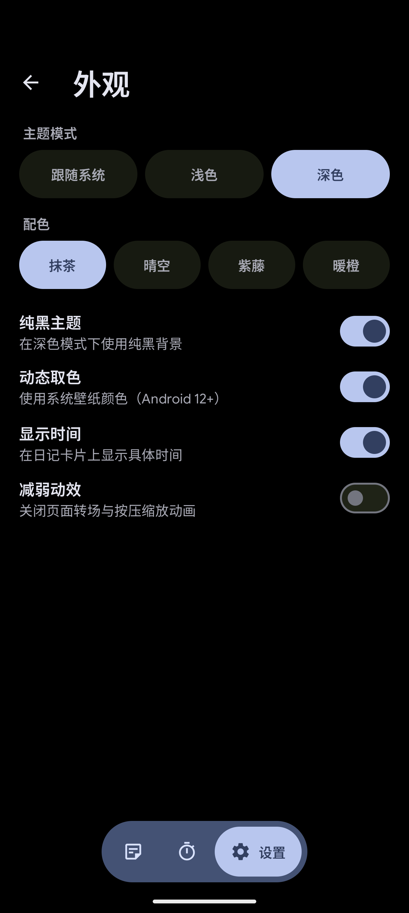
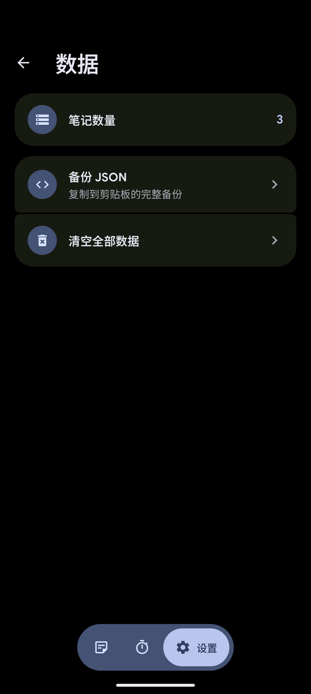
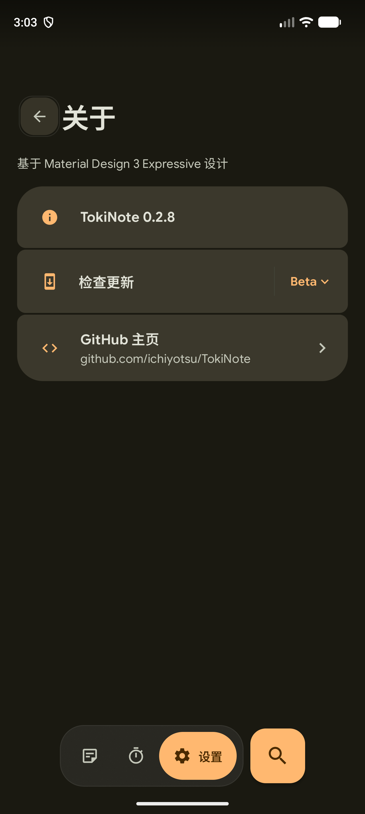

# TokiNote

本地优先的笔记 + 专注应用。设计语言以 [Tomato](https://github.com/nsh07/Tomato) 为基准，
遵循 Material 3 Expressive：大圆角、胶囊控件、悬浮导航栏、分段列表与 Google Sans Flex。

| 日志时间线 | 相册 | 图片查看器 |
| --- | --- | --- |
|  |  |  |

| 编辑器 | 专注 | 统计 |
| --- | --- | --- |
|  |  |  |

| 计时设置 | 外观 | 数据 | 关于 |
| --- | --- | --- | --- |
|  |  |  |  |

## 笔记

- 顶部左对齐「Note」，点按展开搜索；结果按「标题 / 正文」统计后再按日期分组
- 顶栏与分组条使用毛玻璃；底栏是轻量玻璃 + 小圆角矩形按钮：列表 / 日历 / 搜索结果从下方滚过时会真实模糊背后内容
- Expressive 外形：不对称圆角卡片、加粗大标题、细描边的彩色标签、不对称 FAB 与分组胶囊
- 分类页签：**笔记 / 相册 / 统计**
- 首页分组：左侧三条杠打开分组抽屉（TokiNote 标题 + 全部 / 分组 / 新建），分组不再占据主页横向空间；切到相册 / 统计时菜单图标弹性收起、Note 标题左移补位
- 日志：按天分组的卡片，含 emoji、标题、正文预览、描边标签、图片拼贴与时间（可在外观设置里关闭时间）
- 长按卡片会从卡片实际位置膨胀成屏幕中央的预览窗，背景压暗，可直接打开 / 归档 / 删除
- 归档的笔记不进首页且不可编辑；回收站保留 14 天，可恢复或彻底删除
- 相册：当月图片三列网格；点开进入全屏查看器
  - 双指缩放、双击放大
  - 底部悬浮操作条：保存到系统相册 / 查看原笔记 / 图片信息（大小、时间、路径）
- 日历页：月视图，有日记的日子显示当天 emoji，选中日直接列出当天日记
- 编辑器：首图提取主色，驱动背景 / 标题 / 保存按钮 / 底部工具岛；正文与头部全屏滚动、顶栏和工具岛悬浮；向下滚动时标题缩小、日期标签 Spring 收起，回顶弹回；
  图片横幅 + 大标题留白；底部是默认收起、点击后弹性展开的悬浮工具岛；顶部「更多」打开笔记信息面板（创建 / 编辑时间、标签、归档 / 删除）

## 专注

- 专注 25 / 短休息 5 / 长休息 15，长休息间隔可调
- 「波浪断点」计时环 + 中心暂停按钮
- 不定时专注：长按或双击计时数字进入正向计时，重置回到原计时
- 重置 / 跳过 / 计时器设置三个按钮，右下角独立按钮直接进入统计
- 统计页照 Tomato：今天专注与休息卡片、上周柱状图、上个月迷你柱状图
- 计时设置照 Tomato：大号时间预览 + 场景切换 + 预设胶囊 + 自定义（系统时间选择器）

## 设置

- 外观：主题模式、配色预设（抹茶 / 晴空 / 紫藤 / 暖橙）、动态取色、纯黑、显示时间、减弱动效
- 数据：笔记数量、备份 JSON、清空全部数据（同为分段列表项）
- 关于：只保留「基于 Material Design 3 Expressive 设计」、版本、检查更新、GitHub 主页

## 应用内更新

「检查更新」读取 GitHub Releases API 比对版本；有新版时展示 release notes，
可下载 APK 并交给系统安装器（未授权「安装未知应用」时自动跳转设置）。

## 数据存储

所有数据保存在设备本地（`SharedPreferences` + JSON）：`notes` / `labels` / `groups` / `settings` / `sessions`。
只有「检查更新 / 下载 APK」会访问 `api.github.com` 与 GitHub 下载地址。

## 构建

```bash
# 需要 JDK 17+ 与 Android SDK（compileSdk 37）
./gradlew assembleDebug
adb install -r app/build/outputs/apk/debug/app-debug.apk
```

## 工程结构

```
app/src/main/java/com/tokinote/app/
├── MainActivity.kt            入口，主题（深色 / 动态取色 / 配色预设 / 纯黑）
├── data/
│   ├── Note.kt                笔记模型
│   ├── NoteGroup.kt           首页分组模型
│   ├── AppSettings.kt         设置、配色预设与专注记录
│   ├── TokiStore.kt           SharedPreferences + JSON 持久化
│   ├── UpdateChecker.kt       GitHub Releases 检查与 APK 下载
│   └── AppViewModel.kt        单一状态源
└── ui/
    ├── TokiNoteApp.kt         导航栈 + 底栏 + 转场
    ├── Dest.kt                页面路由
    ├── Motion.kt              动效开关、弹簧参数、按压缩放
    ├── components/            顶栏、悬浮导航栏、胶囊按钮组、分段列表
    ├── notes/                 时间线、分组、相册网格、编辑器、图片查看器、日历
    ├── focus/                 番茄钟、波浪环、统计、计时设置
    └── settings/              外观 / 数据 / 关于、APK 安装器
```

## 设计来源与许可

- 视觉基准：[Tomato](https://github.com/nsh07/Tomato)（GPL-3.0）
- 字体：[Google Sans Flex](https://fonts.google.com/specimen/Google+Sans+Flex) 与 [Micro 5 Charted](https://fonts.google.com/specimen/Micro+5+Charted)，随应用打包
- 组件：Jetpack Compose 1.12.1 + Material 3 1.5.0 + Haze 2.0.1（毛玻璃）

## 已知限制

- 计时器仅前台运行（未接前台 Service）
- 富文本是整条日记级的字号/字重，不是局部加粗
- 应用内更新依赖 GitHub 可达；无法安装时会引导用户去系统设置授权
