# TokiNote

TokiNote 是一款本地优先的笔记 + 专注应用，有 Android 版，以及 `ios/` 里的 iPhone / iPad 通用版（0.1.0，iOS 26 / iPadOS 26，兼容 27）。

笔记、图片、标签、个人资料和专注记录全部保存在本机；除了「检查更新」和后续的「公告」之外，应用不会发起网络请求。

## 界面

| 主页 | 分组抽屉 | 我的 |
| --- | --- | --- |
| 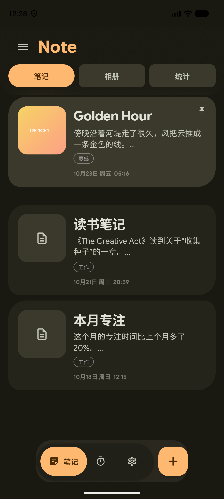 | 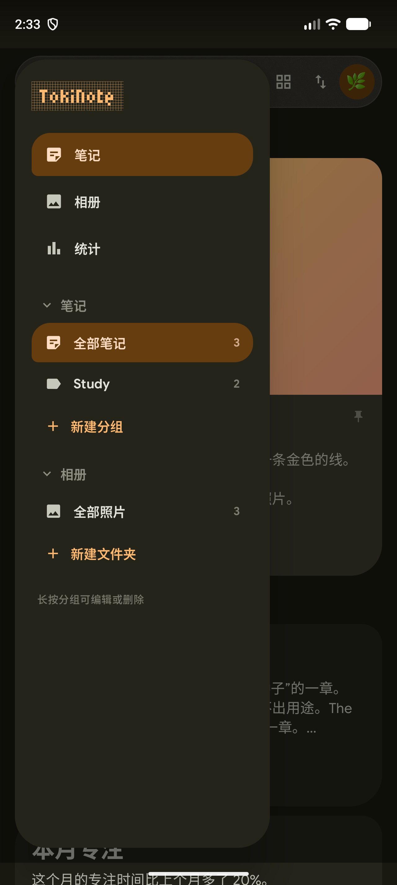 | 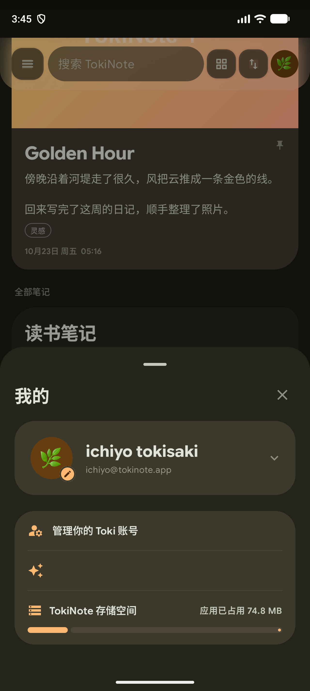 |

| 编辑器 | 相册 | 图片查看器 |
| --- | --- | --- |
| 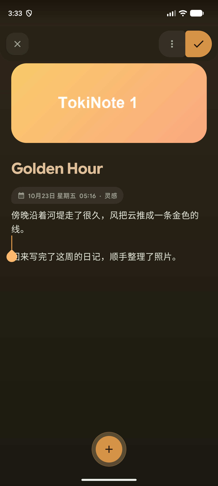 | 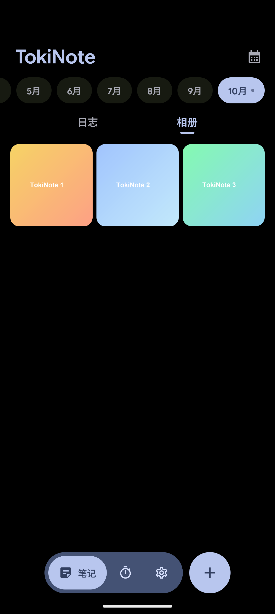 | 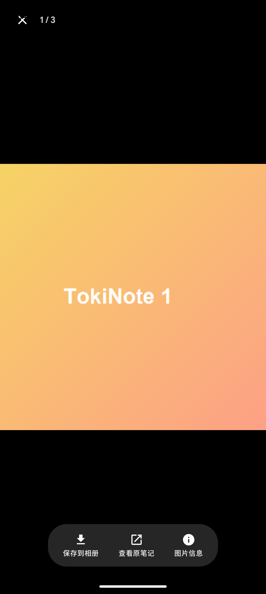 |

| 专注 | 专注总结 | 计时设置 |
| --- | --- | --- |
| 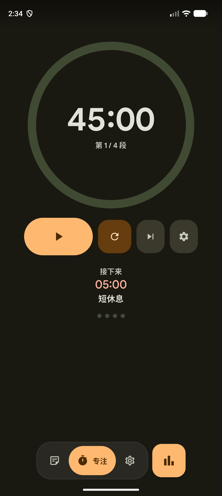 | 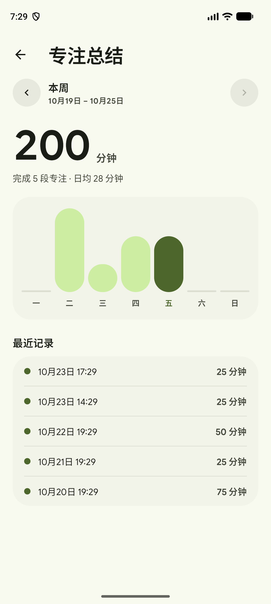 | 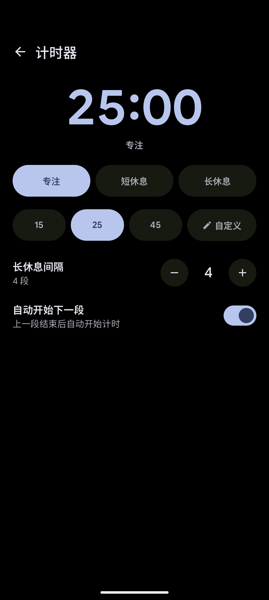 |

| 外观 | 数据 | 关于 |
| --- | --- | --- |
| 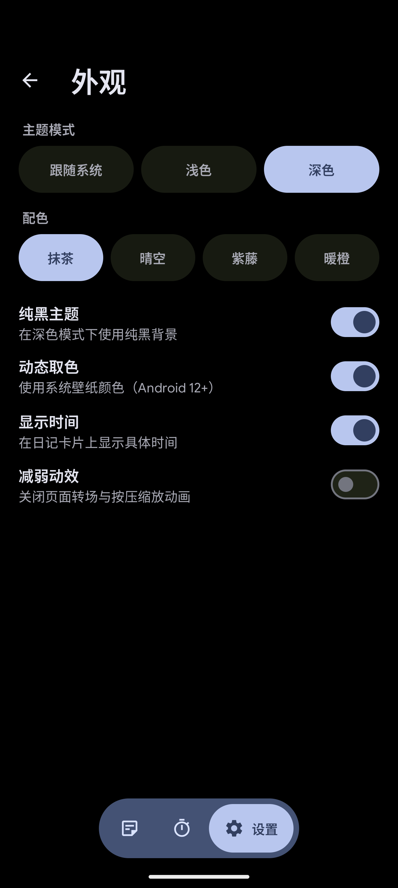 | 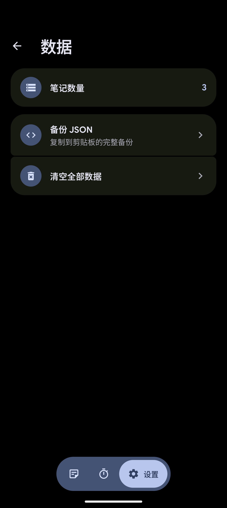 | 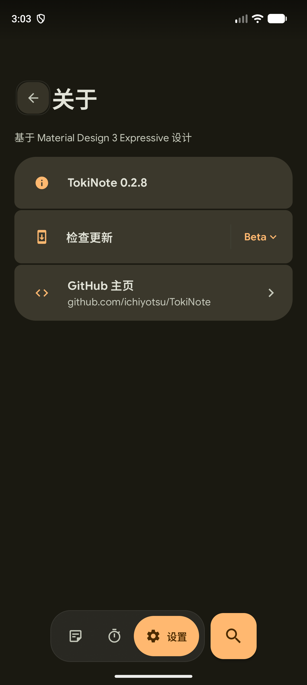 |

## 笔记

- 顶部控制区：导航、搜索、查看方式、排序、头像各自独立；搜索框只有半透明底、无描边，其余为独立悬浮按钮，长按会显示用途提示
- 笔记列表支持「已置顶 / 全部笔记」分区、两列网格与单列列表；有图时图片在卡片顶部铺满，无图时卡片直接从标题开始
- 长按卡片会从卡片位置展开预览，可直接打开、归档或删除
- 左侧悬浮抽屉：笔记 / 相册 / 统计三个入口，笔记分组与相册文件夹可折叠展开，选中项高亮
- 相册文件夹支持命名、多选照片、查看创建时间、编辑和删除；文件夹只记录照片引用，不复制或删除原图
- 相册支持网格 / 列表切换；点开照片进入全屏查看器，支持双指缩放、双击放大、保存到系统相册、回到原笔记和查看图片信息
- 日历视图按天展示日记，有记录的日期显示当天 emoji，选中日期直接列出当天内容
- 编辑器从首图提取主色，驱动背景、标题、保存按钮和底部工具岛；正文与头部整体滚动，顶栏和工具岛悬浮
- 向下滚动时大标题缩小、日期标签弹性收起，顶栏显示当前标题；回到顶部自动恢复
- 底部工具岛默认收起，点击后弹性展开格式、图片、清单和日期工具；顶部「更多」打开笔记信息面板
- 归档笔记不进入主页且不可编辑；回收站保留 14 天，可恢复或彻底删除

## 专注

- 支持专注、短休息、长休息计时，时长与长休息间隔可自定义
- 大尺寸圆角进度环 + M3E 大胶囊主按钮，重置 / 跳过 / 设置独立排列
- 长按或双击计时数字进入不定时正向计时，重置后回到原计时
- 专注总结展示今日专注 / 休息、上周柱状图和上个月迷你柱状图
- 计时设置提供大号预览、场景切换、预设胶囊和系统时间选择器

## 我的

- 点顶栏头像打开「我的」
- 头像可从系统相册选择，也可使用内置 emoji
- 用户名和邮箱可展开编辑，修改立即在全局生效
- 存储卡显示 APK、本地文件和缓存的占用，点击可直接进入系统应用详情
- 管理账号与功能入口当前为占位，点击会提示「功能暂不支持」

## 设置

- 外观：主题模式（跟随系统 / 浅色 / 深色）、配色预设、动态取色、纯黑、显示时间、减弱动效
- 数据：笔记 / 归档 / 回收站数量、备份 JSON、清除缓存、存储占用、清空全部数据
- 关于：版本信息、检查更新（Release / Beta 复合胶囊）、GitHub 主页

## 应用内更新

- 「检查更新」读取 GitHub Releases，比对当前版本后展示更新说明
- 支持 Release 与 Beta 两个通道：
  - Release 只匹配 `0.2.7` 这类标准版本
  - Beta 只匹配 `0.2.9-beta` 这类测试版本
- 有新版本时可直接下载 APK 并交给系统安装器；未授权「安装未知应用」时会跳转系统设置
- 下载失败、网络不可达或没有匹配版本时会在页面内提示，不影响本地功能

## iOS / iPadOS

iOS 版是一个 SwiftUI 通用 App，安装包同时覆盖 iPhone 和 iPad。系统要求 iOS 26.0 或 iPadOS 26.0，同一份构建可以在 26 和 27 上运行。版本号是 `0.1.0`（`CFBundleShortVersionString`）。Bundle ID 是 `com.tokinote.ios`，小组件扩展是 `com.tokinote.ios.widget`。

笔记可以新建、编辑、搜索、置顶；删除后进入回收站，保留 14 天，可以恢复或彻底删除。专注计时和 Android 上已修正的引擎一致：倒计时按经过的时间计算，暂停保留剩余毫秒，进程被杀掉后用保存的截止时间恢复，跳过和「接下来」走同一条规则（每 4 段专注后是长休息），支持不定时正向计时，超过一小时显示 `h:mm:ss`，结束超过 3 秒才回到 App 时只结算当前这一段。统计页有今天、上周和最近 30 天。一段计时会在截止时间安排本地通知，所以 App 在后台时也会响。正在走的计时会显示在灵动岛和锁屏实时活动里，主屏幕可以加专注小组件。设置里可以改主题、配色、纯黑、减弱动效、计时时长，以及手动检查更新。

iPad 使用系统分栏：侧边栏是笔记、专注、统计、设置，笔记再分出列表和编辑器。窗口可以分屏、缩放。接上键盘后，⌘N 新建笔记，⌘1 到 ⌘4 切换栏目，空格开始或暂停，⇧⌘R 重置，⇧⌘. 跳过。

界面文案是简体中文，放在 String Catalog（`ios/TokiNote/Localizable.xcstrings`）里，和 Android 的 `strings.xml` 对齐。视觉用系统导航栏、标签栏和 Liquid Glass（玻璃按钮、系统材质），不自己画一套底栏。

除了启动时和设置里的「检查更新」，iOS 版不访问网络。检查更新请求 `https://api.github.com/repos/ichiyotsu/TokiNote/releases`，只看 tag 以 `ios-` 开头的发布（例如 `ios-0.1.0`），和当前版本比较。有更新时弹出说明，可以下载 IPA，或用 `sidestore://install?url=` 交给 SideStore；本机没有 SideStore 时改为打开发布页面。没有网络时静默跳过，不弹错误。

GitHub Actions（`.github/workflows/ios.yml`）在改动 `ios/` 的 PR 上，用带最新 Xcode 的 macOS runner 跑单元测试，并打一个未签名 IPA。推送 tag `ios-*` 时，把这个 IPA 附到对应的 GitHub Release，且不会把它标成仓库的 Latest（避免盖过 Android 正式版）。

### 用 SideStore 安装

下面的步骤按 SideStore 官方文档整理，链接在 2026-11-09 逐个打开过，都指向官方站点或官方文档里写明的下载地址。安装前再对一下文档，步骤如果变了，以文档为准。

SideStore 是装在 iPhone / iPad 上的侧载工具，用你自己的 Apple ID 给 App 签名，再用一个只连本机的 VPN 完成安装。它是 AltStore 的社区分支。第一次安装需要一台电脑；之后刷新和安装新 App 可以在设备上完成。官方站点是 [sidestore.io](https://sidestore.io/)，文档首页是 [docs.sidestore.io](https://docs.sidestore.io/)。中文安装页：[docs.sidestore.io/zh/docs/installation/install](https://docs.sidestore.io/zh/docs/installation/install)。

#### 你需要准备

- 一台已设置密码的 iPhone 或 iPad。TokiNote 0.1.0 需要 iOS / iPadOS 26 或 27。SideStore 本身按官方前提支持 iOS 15 及以上，但本 App 不能装到更低的系统上。
- 一个 Apple ID（Apple 账户）。免费账户即可，不需要加入付费的开发者计划。
- 一台电脑，只在第一次配对和安装 SideStore 时使用。官方要求 Windows 8 或更高、macOS High Sierra 或更高、较新的 Linux，或未受企业注册限制的 Chromebook。
- 无线局域网。官方说明：安装和刷新时不能只靠蜂窝网络。
- 留出时间处理信任提示、开发者模式和证书刷新。

免费 Apple ID 的限制（来自 [SideStore FAQ](https://docs.sidestore.io/docs/faq)）：

- 同一时间最多 3 个已安装的侧载 App，**SideStore 自己算一个**，所以除此之外通常还能再装 2 个。TokiNote 算 1 个。小组件扩展不另占这 3 个名额，但会多注册 1 个 App ID。
- 7 天内最多新注册 10 个 App ID。卸掉重装、或者带扩展的 App，都会消耗这个额度。
- 描述文件 7 天后过期。过期后打开 App 会提示不再可用，需要在 SideStore 里刷新。付费的 Apple Developer Program（每年 99 美元）可以把有效期放到大约一年，并取消 3 个 App 的限制。

#### 1. 安装 LocalDevVPN

SideStore 用本机 VPN 和设备内部服务通信，流量不出设备。当前文档要求的是 **LocalDevVPN**，不是旧的 StosVPN 或 WireGuard 配置。

1. 在 App Store 安装 [LocalDevVPN](https://apps.apple.com/app/localdevvpn/id6755608044)。
2. 打开它，点 Connect。如果系统询问是否允许添加 VPN 配置，点允许并输入密码。
3. 以后每次安装、更新或刷新 App，都要先连上这个 VPN，并且连着 Wi-Fi。

官方前提说明：[Prerequisites](https://docs.sidestore.io/docs/installation/prerequisites)。排错页写明：如果还在用 WireGuard 或 StosVPN，请改成 LocalDevVPN。

#### 2. 安装 iloader（当前推荐的配对方式）

iloader 是官方现在用来登录 Apple ID、生成配对文件并安装 SideStore 的电脑端工具。配对文件让 SideStore 在不插线时也能和这台设备通信。

- 工具主页：[iloader.app](https://iloader.app)
- 源码与发布：[github.com/nab138/iloader](https://github.com/nab138/iloader)
- macOS：[iloader-darwin-universal.dmg](https://github.com/nab138/iloader/releases/latest/download/iloader-darwin-universal.dmg)
- Windows 安装包（文档推荐 MSI）：[iloader-windows-x64.msi](https://github.com/nab138/iloader/releases/latest/download/iloader-windows-x64.msi)，也可以用 [exe](https://github.com/nab138/iloader/releases/latest/download/iloader-windows-x64.exe)
- Windows 还需要苹果官方的 iTunes：[apple.com/itunes/download/win64](https://www.apple.com/itunes/download/win64)。32 位 Windows 和 Windows 10 on Arm 不受支持。
- Linux amd64：[deb](https://github.com/nab138/iloader/releases/latest/download/iloader-linux-amd64.deb)、[rpm](https://github.com/nab138/iloader/releases/latest/download/iloader-linux-x86_64.rpm)、[AppImage](https://github.com/nab138/iloader/releases/latest/download/iloader-linux-amd64.AppImage)
- Linux arm64：[deb](https://github.com/nab138/iloader/releases/latest/download/iloader-linux-arm64.deb)、[rpm](https://github.com/nab138/iloader/releases/latest/download/iloader-linux-aarch64.rpm)、[AppImage](https://github.com/nab138/iloader/releases/latest/download/iloader-linux-aarch64.AppImage)

用数据线把设备连到电脑。设备上如果出现「要信任此电脑吗」，点信任并输入密码。打开 iloader，用 Apple ID 登录（大小写要和账户一致，不必是设备上登录 iCloud 的那个），选中这台 iPhone 或 iPad，点 **Install SideStore (Stable)**。不要从不明来源下载 SideStore 的 IPA。

JitterbugPair 仍写在官方的[替代 / 过时说明](https://docs.sidestore.io/docs/advanced/alternative)里，只在 iloader 不可用时再考虑。那一页给出的文件是 [macOS](https://github.com/osy/Jitterbug/releases/download/v1.3.1/jitterbugpair-macos.zip)、[Windows 64 位](https://github.com/osy/Jitterbug/releases/download/v1.3.1/jitterbugpair-win64.zip) 和 [Linux](https://github.com/osy/Jitterbug/releases/download/v1.3.1/jitterbugpair-linux.zip)。生成的是 `.mobiledevicepairing` 文件。用网盘传输时扩展名可能变成 `.txt`，先压缩成 zip 再传到设备，SideStore 只接受 `.mobiledevicepairing`。当前安装流程不需要单独做这一步，iloader 会处理配对。

#### 3. 在设备上信任并刷新 SideStore

iOS 26 / iPadOS 26 按官方安装页里 **iOS 18 及以上** 的步骤做（[Install](https://docs.sidestore.io/docs/installation/install)）：

1. 打开「设置 → 通用 → VPN 与设备管理」。
2. 在「开发者 App」里点你的 Apple ID，选择信任。iOS 18 及以后的文案是「允许并重新启动」，按提示输入密码。
3. 打开「设置 → 隐私与安全性」，拉到最下面，打开「开发者模式」。设备会重启，重启后再确认一次。
4. 打开 LocalDevVPN，连接。
5. 打开 SideStore，用在 iloader 里登录的同一个 Apple ID 登录。
6. 进入「我的 App」。
7. 点 SideStore 旁边的 **7 DAYS**（或当前剩余天数）先刷新 SideStore 自己。官方 FAQ 说明：刚装好时要先刷新 SideStore，再装别的 App，否则 App Group 可能不一致，已装的 App 会从列表里消失。
8. 如果问要不要吊销或新建签名证书，选是 / Refresh Now。

成功时 SideStore 会回到主屏幕，几秒后可以再打开。系统更新或抹掉设备之后，配对文件可能失效，需要用 iloader 重新配对。文档也写了，配对有时会无故失效，这是苹果侧的行为。

#### 4. 安装 TokiNote 的 IPA

IPA 没有签名。不能用隔空投送或「文件」直接打开来安装，要交给 SideStore，由它用你的 Apple ID 重签。

1. 确认 Wi-Fi 已连接，LocalDevVPN 已连接，SideStore 已经刷新过自己。
2. 在 GitHub Releases 里找 tag 以 `ios-` 开头的版本，例如 [发布列表](https://github.com/ichiyotsu/TokiNote/releases)。0.1.0 的文件名是 `TokiNote-ios-0.1.0.ipa`。
3. 任选一种安装方式：
   - 在 SideStore 里添加源：`https://raw.githubusercontent.com/ichiyotsu/TokiNote/main/ios/sidestore/apps.json`。也可以点 `sidestore://source?url=https://raw.githubusercontent.com/ichiyotsu/TokiNote/main/ios/sidestore/apps.json`（设备上已安装 SideStore 时才会打开）。源文件在仓库的 `ios/sidestore/apps.json`。`size` 是占位的字节数，第一次真正发布后如果和 IPA 大小不一致，只影响显示，不改变下载地址。
   - 或者在 TokiNote 的更新说明里点「用 SideStore 打开」。这会打开 `sidestore://install?url=` 加上 IPA 的直链（[URL 方案](https://docs.sidestore.io/docs/advanced/url-schema)）。SideStore 仍会再问一次是否安装。
   - 或者把 IPA 下载到「文件」，在 SideStore 里选择从文件安装。
4. 安装完成后如果打不开，回到「设置 → 通用 → VPN 与设备管理」，信任你的 Apple ID。
5. 主屏幕小组件和灵动岛依赖 App Group `group.com.tokinote.ios`。SideStore 重签时需要保留这个权限。如果小组件一直是空白，先在 SideStore 里刷新 TokiNote；App 里的计时不依赖小组件，仍然可用。

#### 5. 每 7 天刷新

免费账户签名的 App 大约 7 天后过期。SideStore 可以在后台尝试刷新，但系统不一定给它足够的后台时间，不要只靠后台刷新。

1. 连上 Wi-Fi，打开 LocalDevVPN 并连接。
2. 打开 SideStore → 我的 App。
3. 点某个 App 旁边的剩余天数，或点全部刷新。先确认 SideStore 自己的天数被推后，再看 TokiNote。
4. 在剩余时间还多于一天时就刷新。过期后再打开，系统会说 App 已不可用。

#### 常见错误

官方列表：[Common Issues](https://docs.sidestore.io/docs/troubleshooting/common-issues)。下面是安装 TokiNote 时最常碰到的几类。

| 现象 | 可以先做的事 |
| --- | --- |
| AFC Connection Failure，或提示没有 Wi-Fi / VPN | 从 StosVPN、WireGuard 换成 LocalDevVPN；关掉 DNS 拦截；确认 Wi-Fi 和 VPN 都连着；重开 SideStore 和 LocalDevVPN；仍失败就用 iloader 更换配对文件。 |
| 安装走到一半停住 | 先更新或重开 SideStore，清缓存，更换 Anisette 服务器，在服务器里重置 adi.pb 后重新登录，重启设备，重建配对文件，最后用 iloader 重装 SideStore。 |
| SideStore 打不开 | 确认是用 iloader 安装的。不行就删掉 SideStore 以及由它安装的 App，再按上面的步骤重装，导入配对文件并登录。 |
| 提示已达到免费账户的 App 数量上限 | 免费账户同时只能有 3 个侧载 App，包括 SideStore。先在 SideStore 里停用或删除一个，再装 TokiNote。 |
| 提示 7 天内只能注册 10 个 App ID | 等已注册的 App ID 过期，或换一个 Apple ID。TokiNote 加上小组件会用掉 2 个 App ID。 |
| 打开 TokiNote 时说「不再可用」 | 描述文件过期了。连上 Wi-Fi 和 LocalDevVPN，在 SideStore 里刷新。 |
| 登录失败，或 Apple ID 被锁 | 多是 Anisette 服务器的问题。在 SideStore 设置里换官方列出的 Anisette 服务器，不要把账户密码交给第三方网页。 |
| 开发者模式找不到 | iOS 16 及以上在「隐私与安全性」最下面。没有这项时，先在「VPN 与设备管理」里信任开发者 App，再重启看一次。 |
| 更新检查没有反应 | 没有 `ios-*` 发布，或 GitHub 连不上。这是预期行为，离线时不会报错。可以稍后在设置里再点「检查更新」。 |

### 发布 `ios-0.1.0`

不要在本地签名。合并到 `main` 之后：

```bash
git tag ios-0.1.0
git push origin ios-0.1.0
```

`.github/workflows/ios.yml` 会在 `xcode-27` runner 上选择已安装的最新 Xcode，跑 `TokiNoteCore` 的单元测试，再用 `CODE_SIGNING_ALLOWED=NO` 打出未签名的 Payload IPA，文件名为 `TokiNote-ios-0.1.0.ipa`，并把它附到这个 tag 的 GitHub Release。说明文字用 `.github/release-notes/ios-0.1.0.md`。这个 Release 不会被标成仓库的 Latest。

发布完成前，`apps.json` 里的下载地址还没有对应文件，SideStore 源会在 IPA 上传之后才能装。装好之后，App 自己的「检查更新」也会认出更新的 `ios-*` tag。

## 数据与隐私

- 所有笔记、图片、标签、分组、相册文件夹、个人资料和专注记录都保存在本机
- 支持导出完整 JSON 备份；清除缓存不会删除笔记
- 不接入匿名统计、账号上报或用户画像，不上传用户 ID、邮箱和笔记内容
- 断网时除检查更新外，所有功能均可正常使用

## 设计

以大圆角卡片、悬浮胶囊、毛玻璃、分段列表和弹性动效为主要视觉语言，支持深色 / 浅色、纯黑与动态取色。

## 已知限制

1. Android 计时器在 `main` 上仍只在前台运行。iOS 版会把完成通知排到截止时间，并使用实时活动显示倒计时。
2. 富文本目前是整条日记级别的字号 / 字重，不是局部加粗
3. 应用内更新依赖 GitHub 可达；无法安装时会引导到系统设置授权
